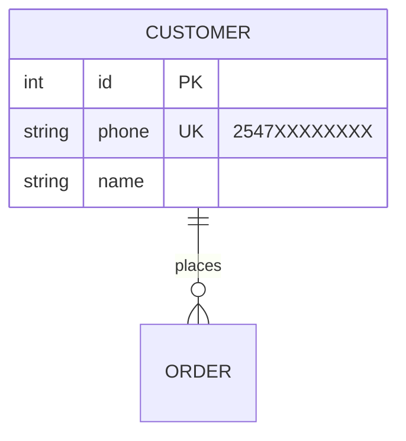

# Day 32: Drawing the Shop

## The brief

Mama Amina runs a shop in Kakamega and takes orders on WhatsApp. Her son wants to build her an ordering app, and before anyone writes a `CREATE TABLE`, she wants to see the plan on one page, in a form she can check: "yes, a customer can order many times", "no, every product is in exactly one category".

That page is an **entity–relationship (ER) diagram**. It's the step between a brief written in words and the tables you build: you name the *things* the business cares about (entities), what you record about each (attributes), and how they connect (relationships). Get the diagram right and the tables nearly write themselves (Day 33). Get it wrong and you find out after the data is in.

You'll draw in **Mermaid**, a text format that GitHub, GitLab and many editors draw as a picture. Paste a diagram into [mermaid.live](https://mermaid.live) to see it as you write.

## What you'll use



- **An entity** is a thing with its own identity that you keep facts about: a customer, a product. Write it in capitals, singular.
- **Attributes** go in its block: `type name`, then `PK` (primary key), `FK` (foreign key) or `UK` (unique: an alternate key), and an optional `"comment"`. The type is a note for people, so `string`, `int`, `decimal` and `datetime` are fine.
- **A relationship** is a line between two entities with a verb as its label: `CUSTOMER ||--o{ ORDER : places`. Each end of the line says how many of *that* entity go with one of the other:

| Left end | Right end | Means |
|---|---|---|
| `\|o` | `o\|` | zero or one |
| `\|\|` | `\|\|` | exactly one |
| `}o` | `o{` | zero or more |
| `}\|` | `\|{` | one or more |

Read `CUSTOMER ||--o{ ORDER` from each side: *each ORDER has exactly one CUSTOMER* (the `||` next to CUSTOMER), and *each CUSTOMER places zero or more ORDERs* (the `o{` next to ORDER). Day 33 goes deeper.

**Kinds of attribute** (exam favourites):

| Kind | Example | Stored as |
|---|---|---|
| Simple | email | one column |
| Composite | full name = first + middle + surname | one column per part |
| Multivalued | phone numbers (any number of them) | a table of its own |
| Derived | age, worked out from date of birth | not stored: calculated when needed |
| Key | customer id | the primary key |

**Chen notation.** Textbooks and GATE papers draw ER diagrams with shapes instead of crow's feet:

```
 +----------+        /\          +-------+
 | CUSTOMER |-----< places >=======| ORDER |   rectangle = entity, diamond = relationship
 +----------+        \/          +-------+   double line === = total participation
       |
   ( name )   ( _id_ )   (( phones ))   ( - age - )
   ellipse = attribute, underlined = key, double ellipse = multivalued, dashed = derived

 #===========#      //\\
 # DEPENDANT #====<< has >>                   double rectangle = weak entity,
 #===========#      \\//                     double diamond = identifying relationship
```

## Steps

1. `starter/shop.mmd`: draw Mama Amina's shop:
   - `CUSTOMER`: `id` (primary key), `name`, `phone` (unique), `town`.
   - `CATEGORY`: `id` (primary key), `name` (unique).
   - `PRODUCT`: `id` (primary key), `name`, `price`, `category_id` (foreign key).
   - `ORDER`: `id` (primary key), `placed_at`, `customer_id` (foreign key).
   - A customer places any number of orders (maybe none yet); each order has exactly one customer.
   - A category groups any number of products; each product is in exactly one category.
   - An order contains one or more products; a product appears in any number of orders, maybe none.
2. `starter/answers.py`: kinds of attribute, the Chen shapes, and how each kind is stored.
3. `pytest phase-3-design/day-032-drawing-the-shop`

## The kata: The Stage

In `starter/kata.mmd`, draw a matatu stage: `SACCO`, `MATATU`, `DRIVER` and `ROUTE`, each with a primary key. A sacco owns many matatus and each matatu belongs to exactly one sacco; each matatu serves exactly one route and a route has many matatus; drivers drive many matatus over a week, and a matatu has many drivers. Give `MATATU` the foreign keys it needs.

## When you're stuck

- **`can't read line ...`**: check the symbols. The left end comes first (`||`, `|o`, `}o`, `}|`), then `--`, then the right end (`||`, `o|`, `o{`, `|{`), then a space, the second entity, ` : ` and a label.
- **"every order has exactly one customer" fails**: that's the symbol at the **CUSTOMER** end: `CUSTOMER ||--o{ ORDER`.
- **The order–product relationship has no foreign key**: right. Many-to-many needs a junction table (Day 21), which Day 33 adds when it turns diagrams into tables. Don't put `product_id` in `ORDER`.
- **`ORDER` turns red in your SQL editor**: `ORDER` is a reserved word in SQL. In the diagram it's fine; the table will be called `orders`.
