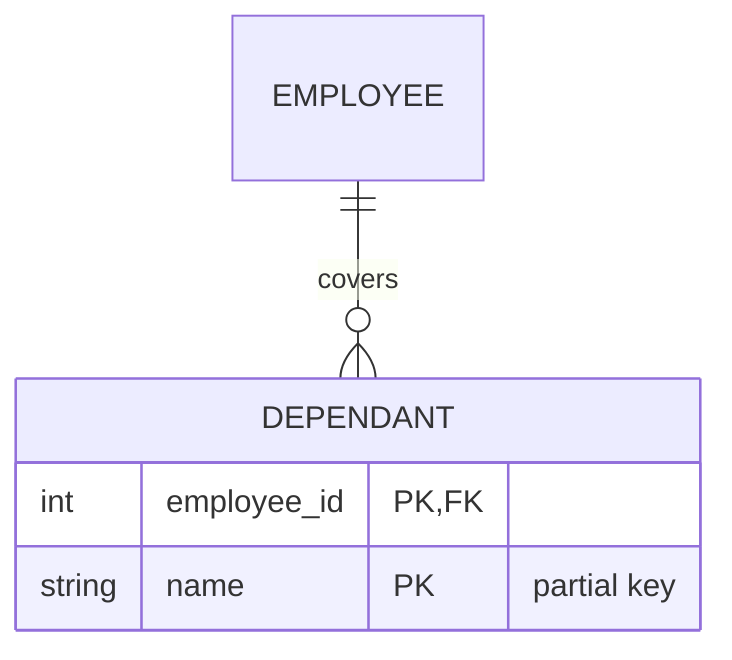

# Day 34: Dependants and Managers

## The brief

A small medical insurer in Nairobi covers its staff and their families. HR has two records it can't fit into ordinary tables.

**Dependants** have no ID of their own: "Ivy" means nothing until you know *whose* Ivy, since two employees both have a child called Ivy. A dependant exists only because of an employee, and when the employee leaves, the cover goes too.

**Managers** are employees too. "Who does Lilian report to?" points from the employees table back into the employees table.

## What you'll use

**A weak entity** can't be identified by its own attributes. It depends on an **owner** (or *identifying*) entity:

- Its key is the owner's key plus a **partial key** (also called a *discriminator*): `(employee_id, name)`. `name` alone is the partial key: unique only within one employee.
- It always has an owner: total participation, so the foreign key is `NOT NULL`, and it's part of the primary key.
- It goes when the owner goes: `ON DELETE CASCADE`.
- Chen draws it as a double rectangle with a double diamond, and underlines the partial key with dashes. In Mermaid, use an **identifying** relationship: a solid line `--`. (A dotted line `..` is non-identifying.)



**A self-referencing (recursive) relationship** links an entity to itself: an employee *manages* employees. In SQL, it's a foreign key into the same table: `manager_id INT NULL REFERENCES employees (id)`. It must allow `NULL`, because somebody is at the top.

To query it, **join the table to itself** under two aliases, one for each *role*:

```sql
SELECT e.name AS employee, m.name AS manager
FROM employees AS e                          -- e plays "the employee"
JOIN employees AS m ON m.id = e.manager_id;  -- m plays "their manager"
```

Each extra level up is another join (`g` for the manager's manager). For "every level, however deep", you need a recursive query (Day 56).

## Steps

```bash
tools/mysql.sh -e "CREATE DATABASE IF NOT EXISTS cover;"
tools/mysql.sh cover < phase-3-design/day-034-dependants-and-managers/setup.sql
```

1. `starter/cover.mmd`: `EMPLOYEE` (`id` PK, `name`, `title`, `manager_id` FK) and `DEPENDANT` (`employee_id` PK and FK, `name` PK, `relationship`, `born_on`). An identifying relationship: each dependant has exactly one employee, an employee has zero or more dependants. And `EMPLOYEE` manages `EMPLOYEE`: non-identifying, at most one manager each, any number of reports.
2. `starter/0-dependants.sql`: `dependants`: `employee_id`, `name` (`VARCHAR(40)`), `relationship` (`'spouse'` or `'child'`) and `born_on` (`DATE`), all required, keyed by employee and name, deleted with their employee. Then load the data: `tools/mysql.sh cover < phase-3-design/day-034-dependants-and-managers/dependants.sql`
3. `starter/1-employees_and_managers.sql`: every `employee` and their `manager` (`NULL` if none). Alphabetical by employee.
4. `starter/2-the_top.sql`: employees with no manager: `name`, alphabetical.
5. `starter/3-team_sizes.sql`: each `manager` and their number of direct `reports`. Most first, ties alphabetical.
6. `starter/4-cover_counts.sql`: every `employee` and how many `dependants` they cover, zero included. Most first, ties alphabetical.
7. `pytest phase-3-design/day-034-dependants-and-managers`

## The kata: The Boss's Boss

In `starter/kata.sql`, list each employee whose manager also has a manager, with that person: `employee`, `grand_manager`. Alphabetical by employee.

## When you're stuck

- **`dependants.sql` fails with `Duplicate entry 'Ivy'`**: your primary key is `name` alone, and two employees have an Ivy. Make it `(employee_id, name)`.
- **Grace Wambui is missing from step 3's list of employees**: a plain `JOIN` drops her, because she has no manager. Use `LEFT JOIN`.
- **`ERROR 1066: Not unique table/alias: 'employees'`**: joining a table to itself needs two different aliases.
- **The team sizes count everyone as 1**: group by the *manager* alias, and count the employees joined to them.
- **The kata includes the Heads of Claims and Finance**: their manager has no manager, so an inner join to the third copy drops them, as it should. Check you used `JOIN`, not `LEFT JOIN`, for `g`.
