# Day 90: Capstone: Matatu Bookings

## The brief

A sacco wants passengers to book matatu seats on their phones. Pick route 46, the 7:00 trip, seat 5; you have two minutes to pay by M-Pesa; then the seat is yours. Phase 7 gave you three databases, and a real system like this uses all three, each for what it's good at:

- **PostgreSQL** holds the truth: routes, trips and confirmed bookings, with constraints that make a double booking impossible.
- **Redis** holds what's fast and short-lived: the two-minute seat holds, which must disappear on their own, and a cache of the route list everyone opens.
- **MongoDB** keeps the story: one event document for every hold, booking, release and fare change, for support staff and reports.

This is the shape of most real back ends: one relational database as the system of record, plus specialised stores beside it.

The three tables in `starter/schema.sql`, drawn. Each arrow runs from a foreign key to the column it references:

[](schema.svg)

## What you'll use

Everything from Days 79 to 89, plus one new idea: **who's responsible for what**.

- A seat is *booked* when a row is in `bookings`. Postgres's `UNIQUE (trip_id, seat)` is the last line of defence: even if the code has a bug, two bookings for one seat can't both commit.
- A seat is *held* when the key `hold:<trip>:<seat>` exists. `SET key phone NX EX 120` sets it only if nobody holds it, and makes it expire, in one atomic command. There's no clean-up job: Redis forgets expired holds for you.
- A seat is *free* when it's neither.
- The route list is read far more than it changes, so it's cached; changing a fare deletes the cache key, so the next read fetches fresh fares (**cache invalidation**).
- Events are written after the real change succeeds, so the log never claims something that didn't happen.

**`SCAN`, not `KEYS`**: `KEYS hold:2:*` walks every key in Redis while everything else waits. `r.scan_iter(match="hold:2:*")` walks in small batches. On a laptop you won't notice the difference; on a server with ten million keys you will.

## Steps

1. `starter/schema.sql`: the three tables. The tests check every constraint.
2. `starter/bookings.py`: `__init__`, `_log`, `_seats` and `_booked` are done. Write `routes`, `set_fare`, `hold_seat`, `confirm`, `release` and `free_seats`.
3. `pytest phase-7-beyond-mysql/day-090-capstone-matatu-bookings`

The tests run against all three of your databases at once. One test has eight passengers tap the same seat at the same moment, from eight connections.

To try it by hand:

```python
import psycopg, redis, pymongo
from bookings import Bookings
pg = psycopg.connect("host=127.0.0.1 port=5434 user=postgres dbname=matatu", autocommit=True)
svc = Bookings(pg, redis.Redis(port=6380), pymongo.MongoClient("mongodb://127.0.0.1:27018").matatu)
```

(after running `schema.sql` and a few `INSERT`s into `matatu`).

## The kata: The Trip Report

In `starter/bookings.py`, write `trip_report(trip_id)`, pulling from two databases: seats booked and takings from Postgres in one query, and from MongoDB how many holds were given up and the hour with the most holds.

## When you're stuck

- **Two passengers both hold seat 1**: you checked with `GET` and then called `SET`. Between the two, someone else got in. Use `set(key, phone, nx=True, ex=120)`, which returns `None` if the key already existed.
- **A passenger can't hold their own seat again**: if the `SET NX` fails, check who holds it. If it's them, `EXPIRE` it again instead of refusing.
- **`free_seats` lists a seat that's held**: the hold keys are `hold:<trip>:<seat>`; take the number after the last colon with `rsplit(":", 1)`.
- **`routes()` returns lists, not tuples**: JSON has no tuples. Turn each row back with `tuple(...)`.
- **The fare change doesn't show up**: delete `cache:routes` in `set_fare`.
- **`set_fare` on a missing route says nothing**: `cur.rowcount` is 0 when an `UPDATE` matches no rows.
- **The kata's takings are `NULL` for a trip with no bookings**: `count(...)` of no rows is 0, but a join can still lose the trip. Start from `trips`, `LEFT JOIN bookings`.
