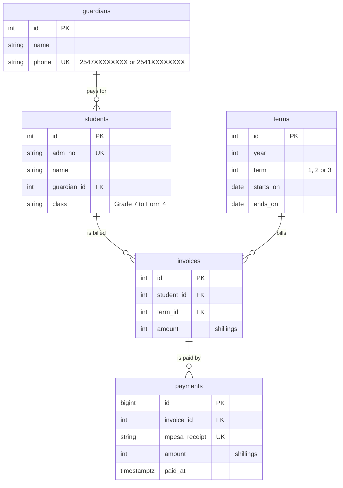

# Shule Fees: design

## Problem

A day secondary school in Machakos collects fees by M-Pesa. The bursar keeps a ledger book and a spreadsheet, and parents phone to ask what they owe. Payments get recorded twice, or against the wrong child, and nobody can say quickly which families are behind. The school needs one database that knows every invoice and every payment, refuses the mistakes, and answers the bursar's five daily questions in milliseconds.

## Data model

- One invoice per student per term (`UNIQUE (student_id, term_id)`); fees differ by class, so the amount is stored on the invoice, not looked up.
- A payment belongs to an invoice, not to a student, so a payment for last term can't quietly count towards this one.
- The M-Pesa receipt is unique: recording the same SMS twice is refused.
- Balances are never stored. They're `invoice amount - sum(payments)`, worked out when asked, so they can't drift.
- Money is whole shillings in `integer` columns; no floats anywhere.

## Access patterns

| # | Question | How often | Query |
|---|---|---|---|
| 1 | What does this student owe? | every parent call, 100 a day | `queries/q1.sql` |
| 2 | Which student did this receipt pay for? | 50 a day | `queries/q2.sql` |
| 3 | Who owes more than 5,000 this term? | weekly, for reminder SMSs | `queries/q3.sql` |
| 4 | What came in on one day? | daily reconciliation | `queries/q4.sql` |
| 5 | How much has each class paid? | weekly, for the board | `queries/q5.sql` |

## Indexes

- `students (adm_no)` unique: question 1 starts from an admission number.
- `payments (mpesa_receipt)` unique: question 2, and the duplicate-SMS rule.
- `payments (invoice_id)`, `invoices (term_id)`, `students (guardian_id)`: every foreign key is indexed, so joins from the parent side and deletes on the parent don't scan the child.
- `payments (paid_at)`: question 4 reads one day out of two years.
- Questions 3 and 5 read a whole term, about a sixth of the invoices and their payments: a sequential scan is the right plan, so there's no index for them.

## Backups and recovery

- Nightly `pg_dump -Fc` at 01:00, kept by grandfather-father-son: 7 daily, 4 weekly, 12 monthly (Day 93).
- WAL archiving to a second disk, so a failure at 16:00 loses minutes, not fifteen hours. RPO: 5 minutes. RTO: 1 hour.
- A restore is rehearsed on the first Monday of each term, and the `fingerprint` (row counts and checksums) compared with production.

## Security

- The app connects as `capstone_app`, which can read every table and insert payments. It can't update or delete anything, and it owns nothing (Day 94).
- The bursar's corrections are new rows (a reversal is a negative adjustment table, planned for version 2), never edits, so the payment history is an audit log by itself.
- Phone numbers are personal data under Kenya's Data Protection Act 2019: only the bursar's office role (planned) sees them in full.

## What I'd do next

- Partition `payments` by year once it passes a few million rows (Day 92).
- A Daraja callback that inserts payments directly, matched by `CheckoutRequestID`.
- Row-level security so class teachers see only their own class.
